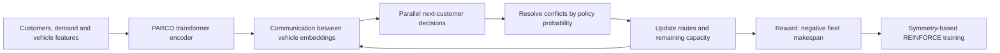

# Fleetweaver

**Learning to weave routes for heterogeneous fleets.** A laptop-scale reproduction
and generalization study of [PARCO (NeurIPS 2025)](https://github.com/ai4co/parco).

Fleetweaver trains the original parallel autoregressive routing architecture from
scratch, checks every evaluated route independently, and compares against classical
heuristics and an OR-Tools solver that supports depot reloads and the same min-max
objective. The project name describes the experiment; the underlying algorithm is
PARCO, credited to its original authors.

## Research question

Can a small PARCO policy trained on 20–40 customers and 3–5 vehicles generalize to
larger fleets, larger problems, and different spatial/demand distributions? Does
training on varied geometry help relative to uniform-only training?

## Reproduce

Python 3.11 or 3.12 is required. CPU execution is the reference path.

```bash
python3.12 -m venv .venv
source .venv/bin/activate
pip install -e '.[dev]'
pytest -q

python -m fleetweaver.train --name mixed-s42 --seed 42
python -m fleetweaver.train --name mixed-s43 --seed 43
python -m fleetweaver.train --name mixed-s44 --seed 44
python -m fleetweaver.train --name uniform-s42 --seed 42 --regime uniform
python -m fleetweaver.benchmark
python -m fleetweaver.report
```

Or run the complete study with `python -m fleetweaver.run_study`. Use `--resume`
to continue interrupted training from the saved optimizer and random states.
`requirements-lock.txt` records the exact package versions used on the original
macOS host; the portable dependency specification is `pyproject.toml`.

## How it works



The objective is the time when the last vehicle returns:

$$\min \max_v \frac{\text{distance of all trips by vehicle }v}{\text{speed}_v}.$$

Vehicles may reload at the shared depot. Every customer must be served exactly
once and each trip must respect that vehicle's capacity. Choosing a short route
for one vehicle is not sufficient: the policy must balance work across the fleet.

See [the declared protocol](configs/study.json) and [provenance and methodological
details](PROVENANCE.md). Training and benchmarking are running; measured results
will replace this sentence when the study completes.

## Scope

This is a scaled reproduction and engineering study, not a claim to reproduce all
published tables or achieve state-of-the-art performance. The official `parco/`
implementation and MIT license are retained. New experiment infrastructure lives
in `fleetweaver/`. All trained weights in the final study originate from random
initialization; no external model API or paid cloud training is used.

## Citation

```bibtex
@inproceedings{berto2025parco,
  title={PARCO: Parallel AutoRegressive Models for Multi-Agent Combinatorial Optimization},
  author={Berto, Federico and Hua, Chuanbo and Luttmann, Laurin and Son, Jiwoo and
          Park, Junyoung and Ahn, Kyuree and Kwon, Changhyun and Xie, Lin and Park, Jinkyoo},
  booktitle={Advances in Neural Information Processing Systems},
  year={2025}
}
```
